# AVD Features in GA in June 2026 – Jean-Loup & Azure

You may have tested them in preview, like me: session host orchestration, dynamic scaling, and ephemeral OS disks on Azure Virtual Desktop. Good news, [since June 2026](https://learn.microsoft.com/en-us/azure/virtual-desktop/whats-new#june-2026) these three advanced host pool management components are announced as generally available. A good opportunity to take stock, gather my three old preview tutorials, and especially to point out what has changed since, because a single detail can break your old deployments.

I had detailed each of these features in a step-by-step tutorial when they were in preview. Rather than redirecting you to three aging articles, I bring them together here in an up-to-date GA summary, with links to each original tutorial if you want to get hands-on again in the portal.

- [1. From Preview to GA: What Really Changes](#FAQ-1)
- [2. Session Host Orchestration](#FAQ-2)
- [3. Dynamic Scaling: Create and Delete, Not Just Turn On and Off](#FAQ-3)
- [4. Ephemeral OS Disks, Finally Native](#FAQ-4)
- [5. The Real Pitfall: Managed Identity Becomes Essential](#FAQ-5)

### 1. From Preview to GA: What Really Changes

Before going into detail, a useful reminder of the fundamental concept. On Azure Virtual Desktop, a shared host pool is managed in two ways:

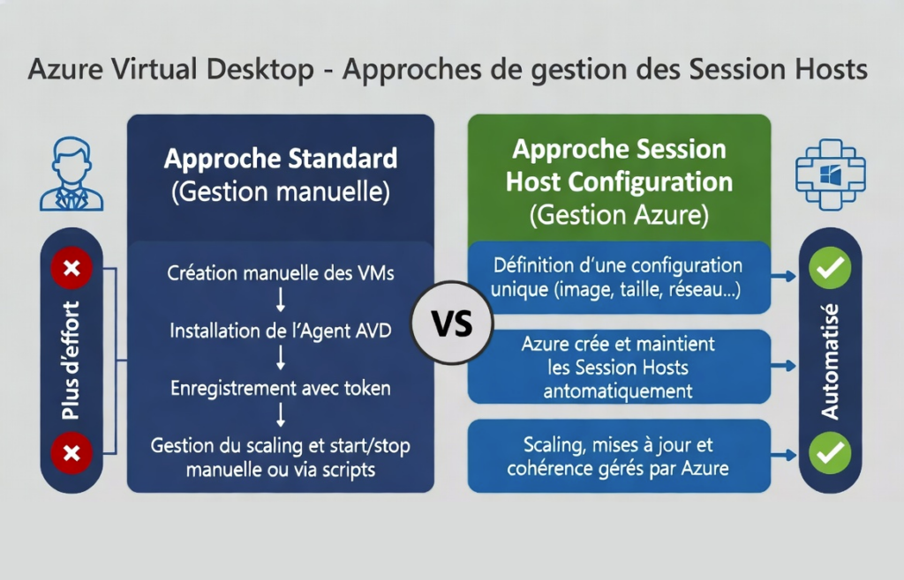

*Standard* management, where you create, update, and scale your hosts with your own tools, and management by **session host configuration**, the one Microsoft calls automated. It is this second approach, and the capabilities around it, that are going GA:

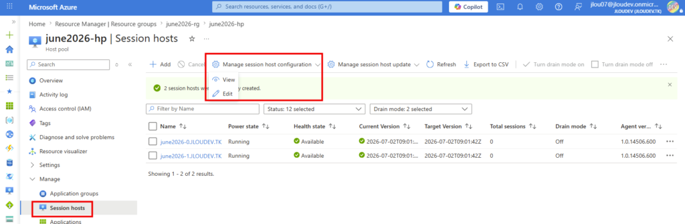

A key point to know right now: the choice of approach is made at the creation of the host pool and cannot be changed afterwards:

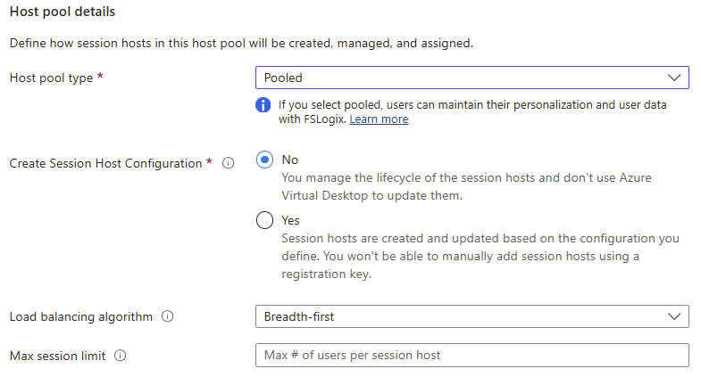

A pool created without session host configuration can never receive one later. This approach also only concerns shared host pools:

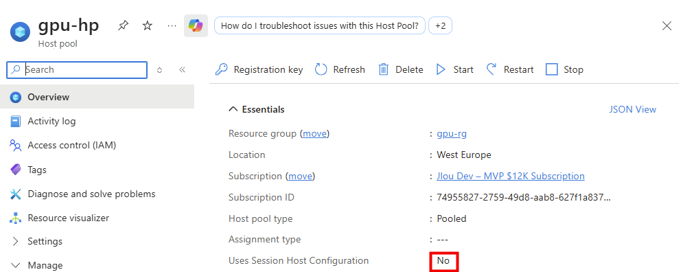

**Watch out:** at the time of writing, some Microsoft reference pages, such as the session host update or managed identity pages, still mention preview. The official changelog, however, clearly announces general availability and distinguishes the features that remain in preview. The most likely explanation is a simple documentation lag, coupled with a progressive rollout. Check in your tenant before any production deployment.

### 2. Session Host Orchestration

This is the central component. The session host configuration describes once and for all what your hosts should be: image, VM size, disk type, security type, domain join, network, identity, tags.

All hosts in the pool align with this single configuration:

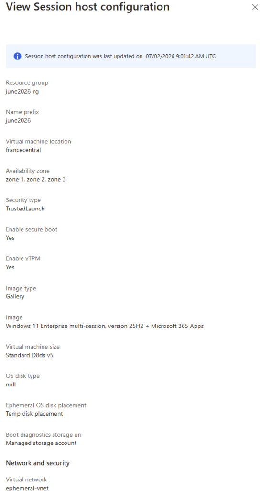

To evolve your fleet, you no longer touch each VM one by one, you modify the configuration:

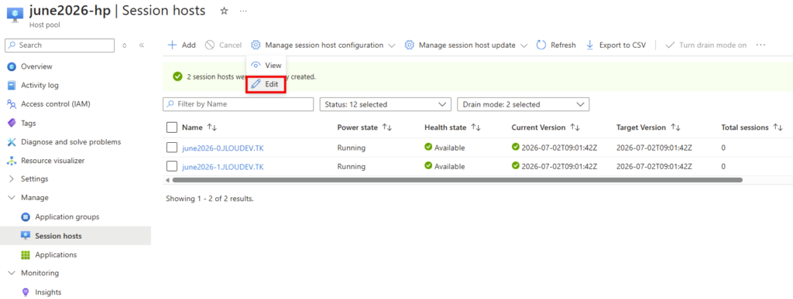

Then you trigger a session host update:

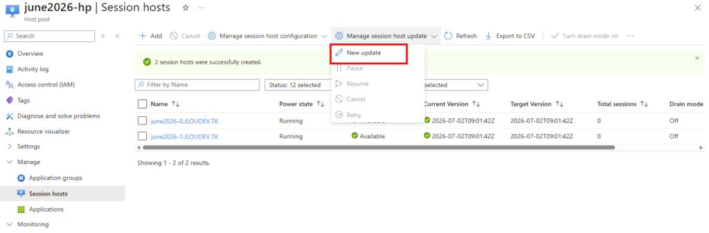

> The session host update allows you to update the underlying virtual machine disk type, the operating system image, and other configuration properties of all session hosts in a host pool with a session host configuration. The session host update deallocates or deletes existing virtual machines and creates new ones that are added to your host pool with the updated configuration.
> 
> Source: [Session Host Update, Microsoft Learn](https://learn.microsoft.com/fr-fr/azure/virtual-desktop/session-host-update)

In practice, the update does not tinker with your VMs in place; it replaces them. The service first targets a single host, called initial, to validate that the process works end-to-end, then processes the rest in batches whose size you set:

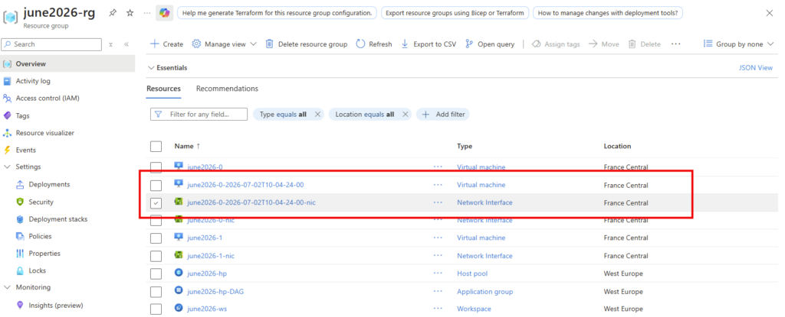

Each affected host goes into drain mode, your connected users receive a notification and a timeout before disconnection, the old VM is removed from the pool, a new one is created from the updated configuration, joined to the domain, then put back into service:

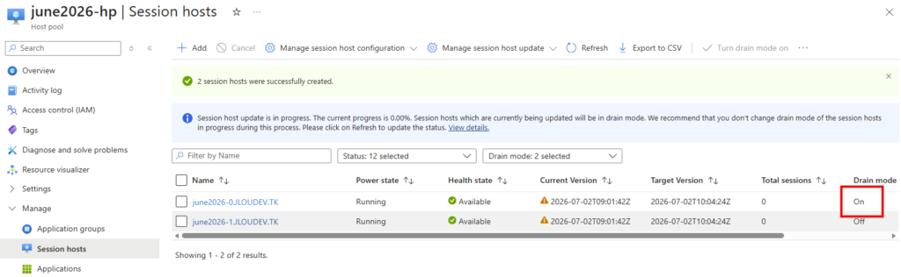

The old VM is finally deleted. Progress only advances when a host is truly finished, which explains why it stays at 0% during the processing of the very first one.

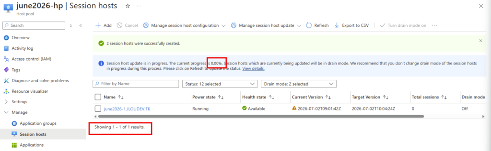

Good to know: the existing power state is respected, so you can launch an update on a pool where all hosts are OFF to limit costs. The complete step-by-step, from managed domain to triggering the update, is still available in my dedicated tutorial: [Orchestrate Your AVD](https://jlou.eu/orchestrez-votre-avd/).

### 3. Dynamic Scaling: Create and Delete, Not Just Turn On and Off

The scaling plan already existed to optimize pool costs.

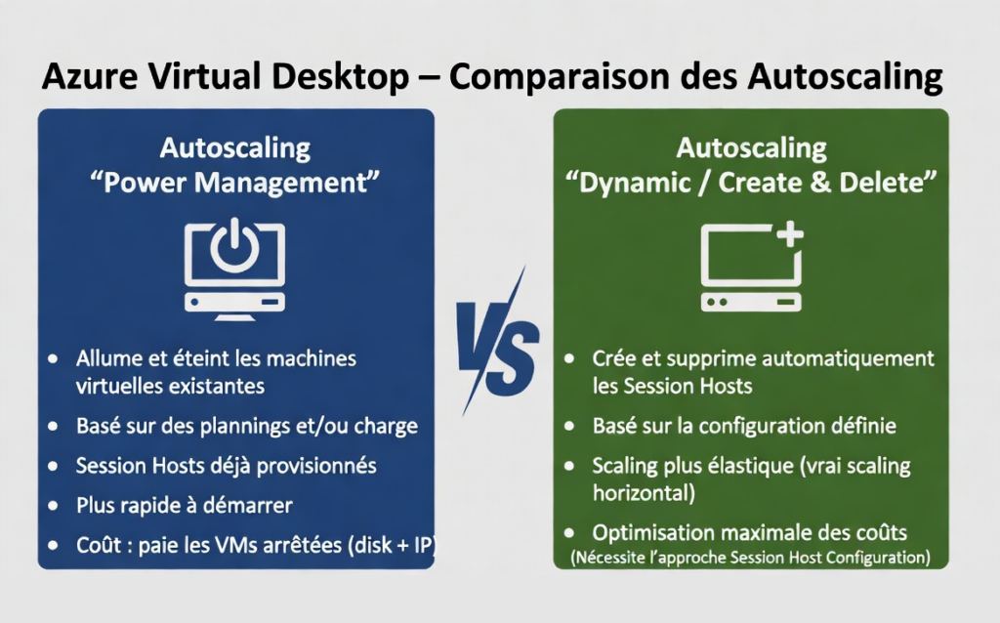

What arrives in GA is its **dynamic** method. The difference is summed up in one sentence:

- In power management, the plan just turns existing VMs on and off:

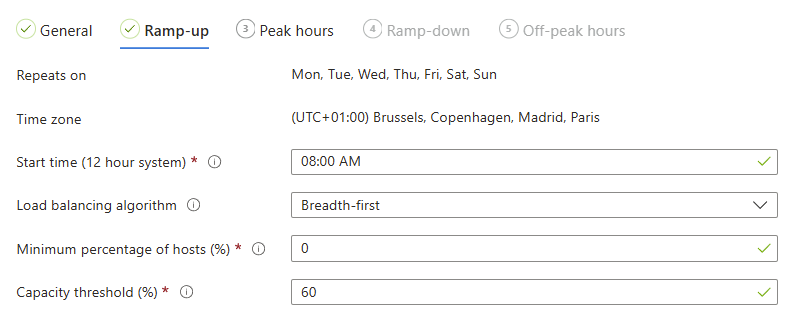

- In dynamic mode, it actually creates and deletes virtual machines based on usage and scheduling, relying on the session host update to recreate them in their latest version:

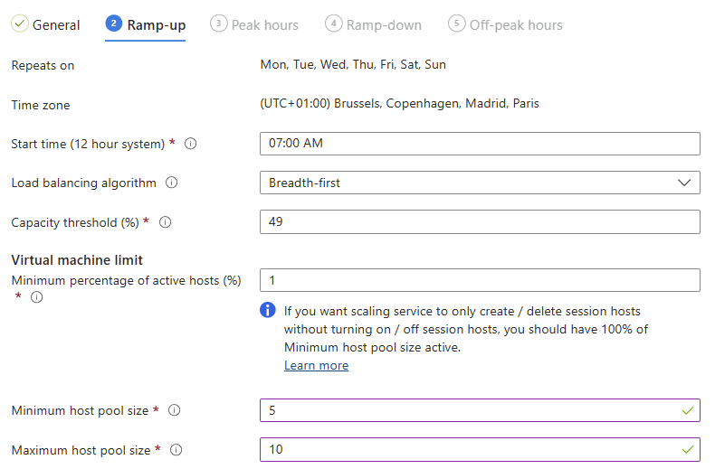

The plan phases remain the same: ramp-up, peak period, ramp-down, and off-period.

You set capacity thresholds, balancing algorithm, minimum and maximum number of VMs, and optional forced disconnect on ramp-down. The benefit of dynamic: when load drops, you no longer pay for idle powered-off VMs, they disappear, then recreate on demand:

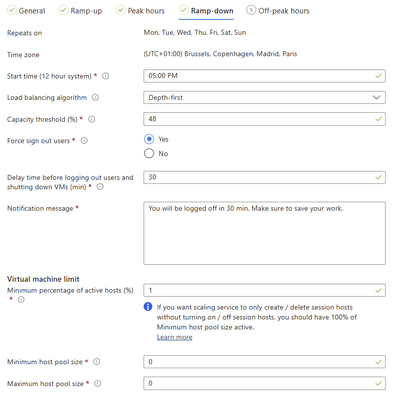

The underlying mechanisms remain the same from one method to the other.

Scaling progressively starts/creates virtual machines when a certain user limit is reached:

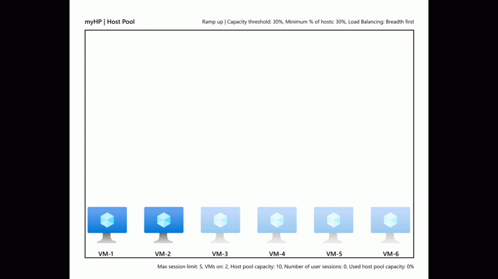

It powers off/deletes virtual machines as long as they are unused:

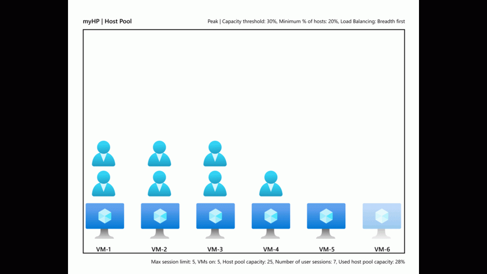

It can force user disconnection, only if you enabled it on ramp-down:

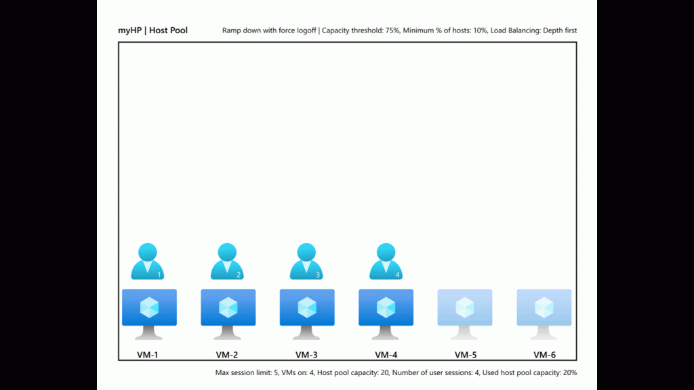

Some caveats to keep in mind: the dynamic method targets shared pools (not personal environments), relies on a pool already configured with session host update, and has restrictions depending on join type and hosting.

The full walkthrough, with live VM creation and deletion tests, is in my tutorial: [AVD and Dynamic Scaling](https://jlou.eu/autoscalingv2/).

### 4. Ephemeral OS Disks, Finally Native

The third component, ephemeral OS disks.

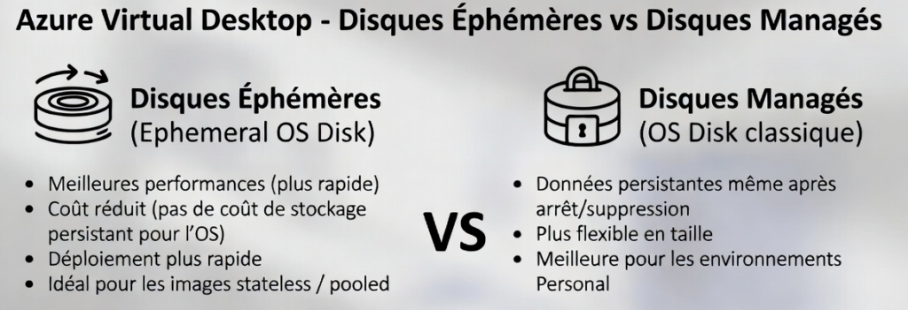

The principle: the system disk lives on the host's local storage, not on managed remote storage:

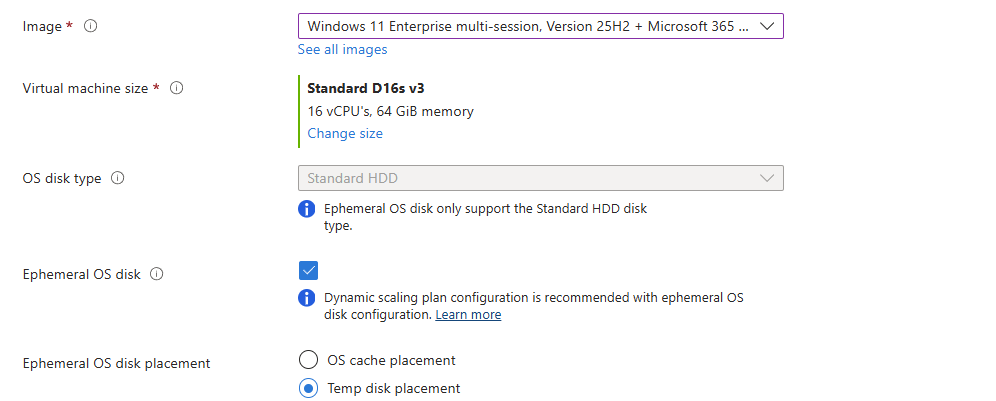

Result: lower latency reads and writes, faster provisioning and reset:

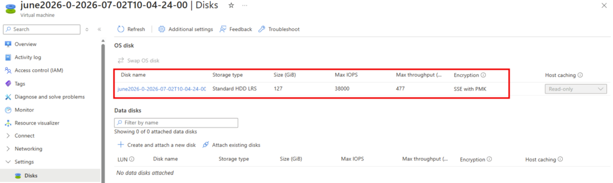

And a cost included in the VM size price:

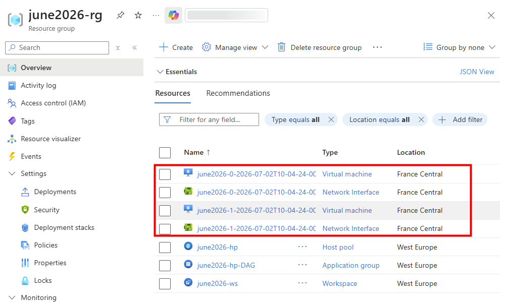

The trade-off is assumed, these disks retain nothing beyond the machine's lifecycle:

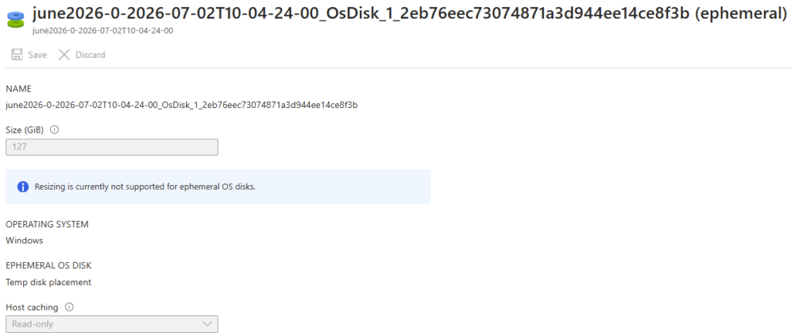

The GA change is here. In preview, the AVD creation interface did not allow choosing an ephemeral disk, which forced a workaround: create VMs manually then attach them to the pool:

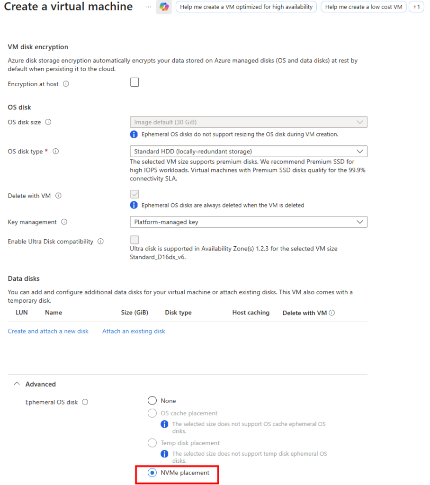

Microsoft now announces ephemeral disks available and optimized for Azure Virtual Desktop, and the session host configuration includes OS disk information. Support thus becomes official and integrated, instead of a manual mount.

To fully grasp the different ephemeral disks on Azure, John Savill's excellent video remains the best introduction:

The constraints remain the same, and you need to know them: no VM backup, no deallocation, and resizing causes data loss. For an AVD pool built on a golden image and that does not store user data, these are not blockers, rather properties to accept.

My performance comparison between Premium SSD, cache, and temporary disk, with DiskSpd tests, is here: [Attach an Ephemeral Disk to Your AVD](https://jlou.eu/associez-un-disque-ephemeres-a-votre-avd/). The Microsoft reference on the subject remains [the ephemeral OS disks page](https://learn.microsoft.com/fr-fr/azure/virtual-machines/ephemeral-os-disks).

### 5. The Real Pitfall: Managed Identity Becomes Essential

If you reread my old tutorials, you will see that I relied on the Azure Virtual Desktop service application permissions, with RBAC roles assigned manually on the Key Vault and a custom role for reading the configuration. This mechanism is no longer the right one. Microsoft has switched to **managed identity**, and this is not just a recommendation:

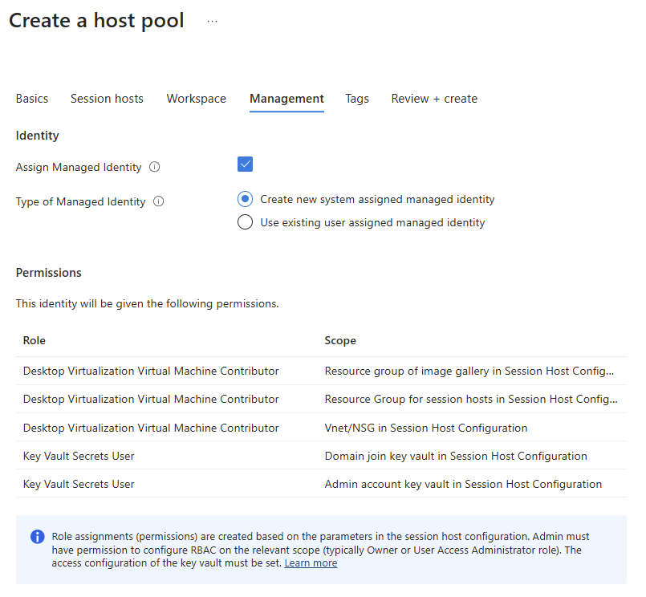

**Attention:** Managed identity has become mandatory for pools using a session host configuration. Microsoft's announced timeline is clear: since September 19, 2025, any new pool of this type must be created with a managed identity; since October 15, 2025, an existing pool can no longer update its configuration without adding one; and since November 15, 2025, it can no longer create hosts without it. If you are still following the service principal method from my older articles, you will hit a wall.

The good news is that managed identity simplifies the picture. It removes the need to assign permissions to the Azure Virtual Desktop service application, automatically assigns rights based on the session host configuration settings, and provides finer control per pool:

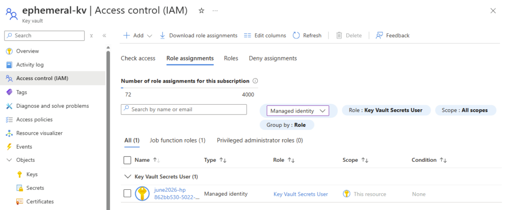

It also unlocks two concrete scenarios: access to a Key Vault with public access disabled, reserved for trusted Microsoft services, and the use of an image hosted in another subscription within the same tenant. The procedure is described on [the managed identity configuration page](https://learn.microsoft.com/fr-fr/azure/virtual-desktop/configure-managed-identity).

### Concretely, what does this mean?

Here is a summary of three preview components combined and upgraded for general availability: session host configuration to standardize and update your fleet, dynamic scaling to create and delete VMs based on load, and ephemeral disks now properly integrated.

Key pitfalls to remember:

1. Managed identity is no longer optional; forget the service principal method from my old tutorials.
2. The management approach is chosen when creating the pool and cannot be changed afterward.
3. Ephemeral disks do not persist anything, perfect for a golden image, but to be avoided for user data.
4. Some documentation pages still carry the preview label; check the actual status in your tenant before production.

For step-by-step details on each component, my original three tutorials remain the reference: [orchestration](https://jlou.eu/orchestrez-votre-avd/), [dynamic scaling](https://jlou.eu/autoscalingv2/), and [ephemeral disks](https://jlou.eu/associez-un-disque-ephemeres-a-votre-avd/). Go ahead and test all this in a lab now that production is allowed. To follow updates, keep an eye on the [Azure Virtual Desktop What’s New](https://learn.microsoft.com/fr-fr/azure/virtual-desktop/whats-new).